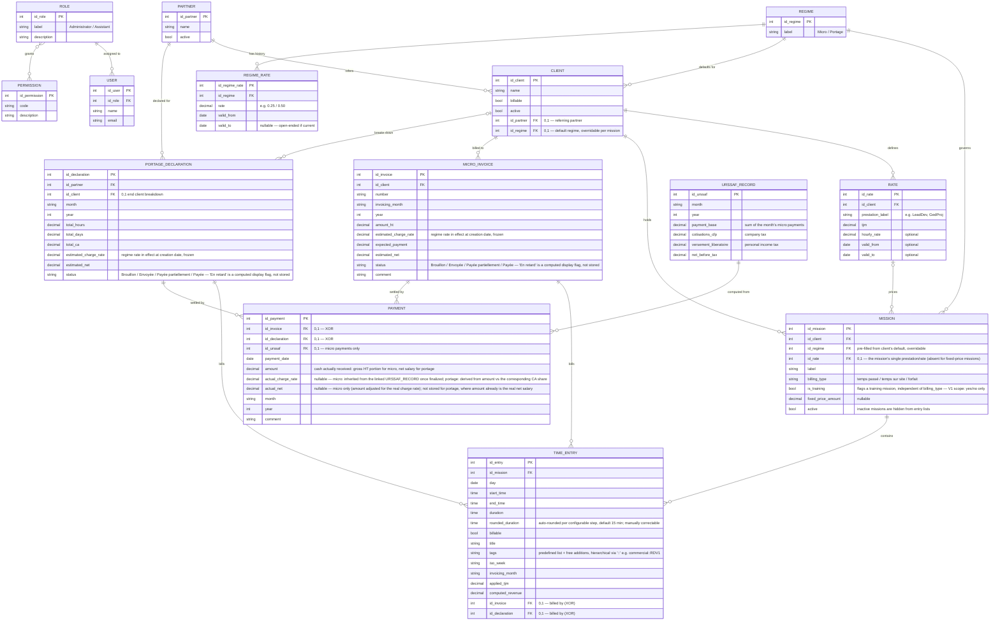

# SynFactu — Conceptual Data Model (MCD)

> Merise-style conceptual data model for SynFactu. Domain terms with no clean English equivalent are kept as-is: TJM (daily rate), URSSAF, portage, CFP, versement libératoire. This document is referenced by section 4 of the functional specification.

---

## 1. Entity-Relationship Diagram

> Note: one `URSSAF_RECORD` per month. The URSSAF amount due for a month is computed from the micro payments actually received that month, so each micro PAYMENT is linked to the month's URSSAF_RECORD (see RG-08).

---

## 2. Entity Dictionary

**PARTNER** — A partner who refers end clients (e.g. DigitalEase, Datapix, Pando Studio). The party that is actually invoiced under the portage flow.

**CLIENT** — An end client. Optionally linked to a referring PARTNER. Carries the `billable` flag (some clients are non-billable, e.g. internal/commercial time).

**REGIME** — Billing regime: micro-entreprise or portage. Kept as a reference entity; its charge rate is no longer a single static value (see REGIME_RATE).

**REGIME_RATE** — Historized charge rate for a regime (approx. 25% micro, approx. 50% portage), with a validity period (`valid_from`/`valid_to`). Rates change over time (e.g. legal URSSAF scale updates); each MICRO_INVOICE/PORTAGE_DECLARATION freezes the rate valid on its **creation date** into its own `estimated_charge_rate`, so past documents are unaffected by later rate changes.

**RATE (TJM)** — A daily rate for a given prestation of a given client. A client can have several rates (e.g. Yanet LeadDev 499.87 vs GedProj 650.02). Optional validity dates allow rate history.

**MISSION** — An engagement for a client under one regime. `billing_type` distinguishes how it is billed: `temps passé` (time-based), `temps sur site` (on-site only), or `forfait` (fixed-price). `is_training` is a separate, orthogonal flag (any billing type can be training or not); it exists so all training missions can be listed easily over a year. For V1 it is a plain boolean — subcontracted/direct classification and the full training-activity tooling are deferred (see section 5).

**TIME_ENTRY** — A single line of the "Temps passé" journal: date, start/end, duration and rounded duration, billable flag, ISO week, the invoicing month it is affected to, the applied TJM and the computed revenue. Optionally linked to the invoice or portage declaration that bills it (a billable entry not yet linked is part of the billing backlog).

**MICRO_INVOICE** — A micro-entreprise invoice: number, month, client, amount HT, estimated charge rate (frozen at creation), expected payment, estimated net, status. The **real** charge rate/net are not stored here: they live on its linked PAYMENT(s) (see PAYMENT, RG-22).

**PORTAGE_DECLARATION** — The portage breakdown for a partner (and optionally per end client) for a given month: hours, days, CA, estimated charge rate (frozen at creation), estimated net, status. The **real** net/charge rate are not stored here either: they live on its linked PAYMENT(s) — i.e. the salary payment(s) received (see PAYMENT, RG-22).

**PAYMENT** — An incoming payment, linked to **either** a MICRO_INVOICE **or** a PORTAGE_DECLARATION (exclusive — see RG-04). This is where the **real** figures live: `actual_charge_rate` and (for micro) `actual_net`, once known (see RG-22). For micro, `amount` is the gross cash received and the real rate is inherited from the month's URSSAF_RECORD; for portage, `amount` already is the real net salary, so only `actual_charge_rate` is derived, not a redundant `actual_net`.

**URSSAF_RECORD** — A monthly URSSAF record for the micro regime, separating cotisations + CFP (company tax) from versement libératoire (personal income tax). Its base is the sum of the micro payments received during the month; those payments are linked to the record.

**USER / ROLE / PERMISSION** — Access management. A user has one role; a role grants a set of permissions. Detailed permission matrix to be defined later.

---

## 3. Cardinalities (Merise)

- PARTNER (0,n) — refers — CLIENT (0,1)
- REGIME (1,1) — governs — MISSION (0,n)
- REGIME (0,1) — defaults for — CLIENT (0,n)
- REGIME (1,1) — has history — REGIME_RATE (0,n)
- CLIENT (1,1) — defines — RATE (0,n)
- CLIENT (1,1) — holds — MISSION (0,n)
- RATE (0,1) — prices — MISSION (0,n)
- MISSION (1,1) — contains — TIME_ENTRY (0,n)
- CLIENT (1,1) — billed to — MICRO_INVOICE (0,n)
- PARTNER (1,1) — declared for — PORTAGE_DECLARATION (0,n)
- CLIENT (0,1) — breaks down — PORTAGE_DECLARATION (0,n)
- MICRO_INVOICE (0,1) — settled by — PAYMENT (0,n)
- PORTAGE_DECLARATION (0,1) — settled by — PAYMENT (0,n)
- URSSAF_RECORD (0,1) — computed from — PAYMENT (0,n)
- ROLE (1,1) — assigned to — USER (0,n)
- ROLE (0,n) — grants — PERMISSION (0,n)

---

## 4. Business Rules (RG)

- **RG-01** — A client may or may not be linked to a partner. If linked, it is an end client reached through that partner; if not, it is a direct client. PARTNER and CLIENT remain **separate entities** (decided): when a partner is also billed directly, a matching CLIENT record is created for it, optionally referencing the PARTNER.
- **RG-02** — A client can have several rates (TJM) according to the prestation, but **each mission covers exactly one prestation/rate** (decided): if the prestation changes, a new mission is created rather than switching the rate on an existing mission.
- **RG-03** — Gross vs net: at invoicing/declaration, the net is an **estimate** derived from the regime charge rate (approx. 25% micro, approx. 50% portage), frozen on the document at creation (RG-20). The **real** net/charge rate are never stored on the document itself: they are recorded per PAYMENT once known (RG-22). Statistics mix estimated figures (unreconciled payments) with real figures (reconciled payments) so in-progress billing is still reflected.
- **RG-04** — A payment settles **exactly one** of: a micro invoice OR a portage declaration (exclusive — the two foreign keys are mutually exclusive, never both, never neither).
- **RG-05** — A non-billable client/mission produces time entries with `billable = false` and zero revenue; these still count toward the real billing rate calculation.
- **RG-06** — For `temps sur site` missions, unbilled time is tracked to compute a real billing rate vs the invoiced TJM. For `forfait` missions, total time is tracked to derive the real TJM.
- **RG-07** — A user has exactly one role; an administrator has full access, an assistant has a restricted scope (time entry, URSSAF, etc.).
- **RG-08** — URSSAF (micro) is paid based on the payments received during the month: the URSSAF_RECORD of a month aggregates the micro payments received that month, and its base/cotisations/versement libératoire are derived from them. Only micro payments are linked; portage payments are excluded.
- **RG-09** — A mission can be flagged inactive; inactive missions are excluded from the selection lists during time/invoice entry but remain in the database and in historical views.
- **RG-10** — Amount to invoice (work value): for `temps passé` and `temps sur site` missions, the value is the sum of the billable time entries (hours/days x applied TJM); for `forfait` missions, the value is the agreed `fixed_price_amount` of the mission (time is tracked only to compute the real TJM).
- **RG-11** — Billing backlog ("encours a facturer") = work value (RG-10) minus the amount already invoiced. A total can be invoiced in several invoices/declarations over time (each billing covers a subset of time entries, or a fraction of a forfait); no fixed schedule is planned, only the running delta is tracked.
- **RG-12** — Outstanding amount ("reste a payer") = amount invoiced minus the sum of linked payments. An invoice or portage declaration can be settled by several payments over time (the client may decide to pay in installments after the fact).
- **RG-13** — A client may carry a **default regime**; a new mission is pre-filled with it but can override it if the mission's actual regime differs.
- **RG-14** — Invoice numbering (`2026-01-001_Client_mission`): the sequence **resets to 001 every month** (year-month-sequence), scoped to micro invoices.
- **RG-15** — Status of a MICRO_INVOICE / PORTAGE_DECLARATION: `Brouillon → Envoyée → Payée partiellement → Payée`. Brouillon/Envoyée are set manually; Payée partiellement/Payée are derived from linked payments. "En retard" is a computed dashboard flag (see section 6.5 of the functional spec), not a stored status.
- **RG-16** — When creating a billing (invoice or declaration), the system **pre-selects** all unlinked billable time entries for the relevant client/mission/month; the user can deselect entries before validating.
- **RG-17** — Time entry rounding step is a **configurable application setting** (default: 15 minutes); the computed rounded duration remains manually correctable per entry.
- **RG-18** — Tags on time entries follow a **predefined base list**, extensible with user-added tags, and support **hierarchy via `::`** (e.g. `commercial::RDV1`, `commercial::rédactionProposition`).
- **RG-19** — Regime charge rates are **historized** via REGIME_RATE (rate + `valid_from`/`valid_to`); REGIME itself no longer stores a single static rate, since the rate can change over time (e.g. legal URSSAF scale updates).
- **RG-20** — When a MICRO_INVOICE or PORTAGE_DECLARATION is created, the system looks up the REGIME_RATE valid on the **document's creation date** (not the invoicing month) and freezes it into `estimated_charge_rate`; the field remains manually editable if needed. Past documents are never retroactively affected by a later rate change.
- **RG-21** — No automated alerting on upcoming/recent regime rate changes in V1 (deferred); a future rate is simply entered ahead of time with its `valid_from` date and takes effect automatically once reached.
- **RG-22** — The **real** charge rate/net are recorded on `PAYMENT`, not on `MICRO_INVOICE`/`PORTAGE_DECLARATION`, since a single invoice/declaration can be settled by several payments, each potentially with its own real rate (e.g. installments spanning different URSSAF months). For **micro** payments, `actual_charge_rate` and `actual_net` are **auto-computed** once the linked `URSSAF_RECORD` is finalized (all payments of the same record inherit that month's real rate uniformly); `amount` itself is the gross cash received, not the net. For **portage** payments, `actual_charge_rate` is derived from `amount` against the corresponding CA share once the payslip is entered; `actual_net` is **not** stored separately, since `amount` already is the real net salary received.
- **RG-23** — A `PAYMENT` is considered "reconciled" (real rate known) simply when its `actual_charge_rate` is not null; no separate reconciliation flag/status is introduced. An invoice/declaration-level real rate, when needed for stats, is computed on the fly as the amount-weighted average across its reconciled payments — it is never stored on the invoice/declaration itself.
- **RG-24** — `billing_type` (renamed from `mission_type`) has three values: `temps passé` (time-based), `temps sur site` (on-site only), `forfait` (fixed-price). Training is **not** one of them: it is a cross-cutting classification, not a billing stream.
- **RG-25** — `MISSION.is_training` is a plain **boolean** in V1, orthogonal to `billing_type` (a training mission is still billed via one of the three values above). It exists so all training missions can be listed easily over a year. Subcontracted/direct classification (`training_mode`) and the full "Déclaration d'Activité de Formation" tooling are deferred to a later phase.

---

## 5. Open Questions

All model-level open questions from previous rounds are resolved (see RG-01, RG-02, RG-08, RG-13 through RG-25). Remaining open:

- **Permission granularity** — The PERMISSION entity is a placeholder; the exact permission set and the assistant's scope are **deliberately deferred** until the role is actually implemented (per user decision).
- **Training direct classification** — V1 only carries the plain `is_training` flag on MISSION (RG-25). The subcontracted/direct distinction (`training_mode`) and the full classification for the French "Déclaration d'Activité de Formation" are deferred to a later phase.
- **Excel history migration** — Scope and timing of importing the legacy workbooks are deferred, to be discussed later.
